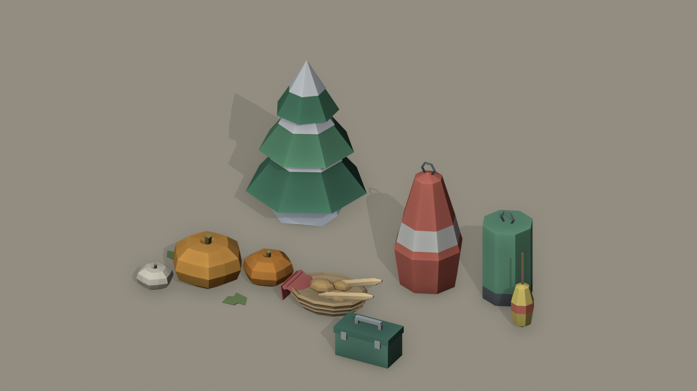

# Cozy Low-Poly Free Sampler (CC0)

Five free low-poly 3D props in one matching flat-color style, for games, prototypes, renders and 3D printing references. Public domain (CC0): use them in commercial projects, no credit needed.

## Models

| Model | Triangles | Size in meters (X, Y, Z) | Materials |
|---|---|---|---|
| Snowy_Pine | 112 | 1.852 x 1.807 x 2.712 | 5 |
| Pumpkin_Trio | 536 | 1.185 x 0.892 x 0.439 | 5 |
| Buoy_Set | 292 | 1.470 x 0.750 x 1.142 | 6 |
| Tackle_Box | 84 | 0.520 x 0.290 x 0.350 | 3 |
| Bread_Basket | 836 | 0.818 x 0.536 x 0.247 | 5 |

Total: 1,860 triangles. Figures come from `manifest.json`.

## Files

- `glb/` glTF 2.0 binary, one per model
- `fbx/` FBX, one per model
- `previews/` cover and scene renders
- `manifest.json` triangle counts, dimensions, material names
- `LICENSE.txt` CC0 1.0 dedication

## Specs

- Real-world scale in meters, origin at the base center
- Flat-color materials, no textures, easy to recolor
- Metallic is 0 on every material
- Made in Blender 5.2 with Python scripts

## Using them

- **Godot / Unity / Unreal / three.js:** drag a `.glb` (or `.fbx`) into the project.
- **Blender:** File > Import > glTF 2.0 (.glb/.gltf), or FBX.
- Engine import was not tested for this release; check scale and materials in your own pipeline.

## License

CC0 1.0 Universal. See `LICENSE.txt`. The CC0 dedication covers only the five models in this repo.

## Provenance

Every model was checked in rendered previews before release. There is no third-party content.

## More

These five props are samples from a larger series of paid Cozy low-poly packs by Jarvis Ross (find them on itch.io under Jarvis Ross). The packs are separate products with their own license.
